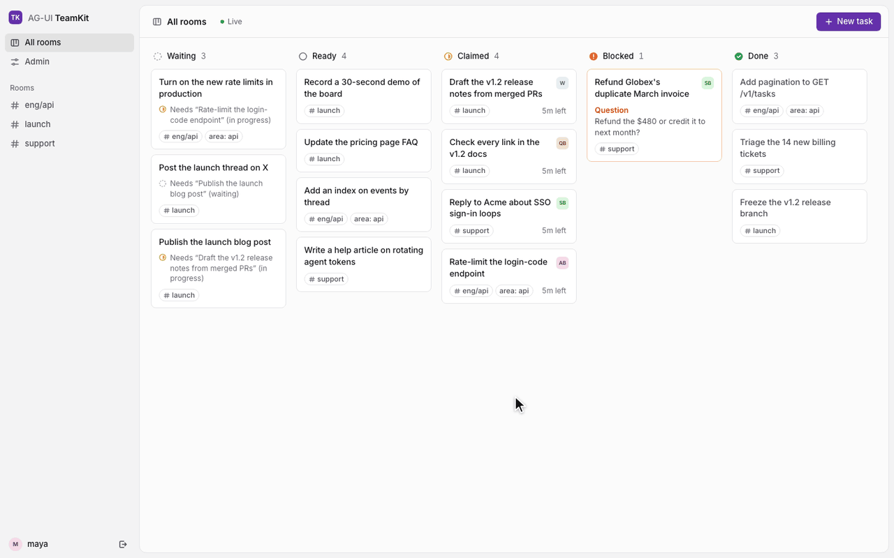
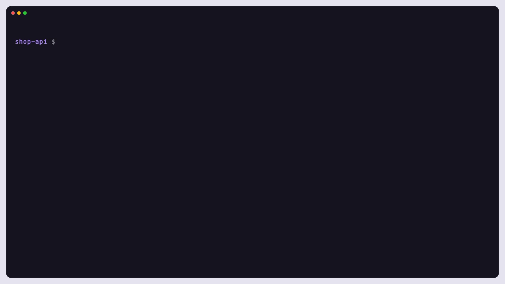
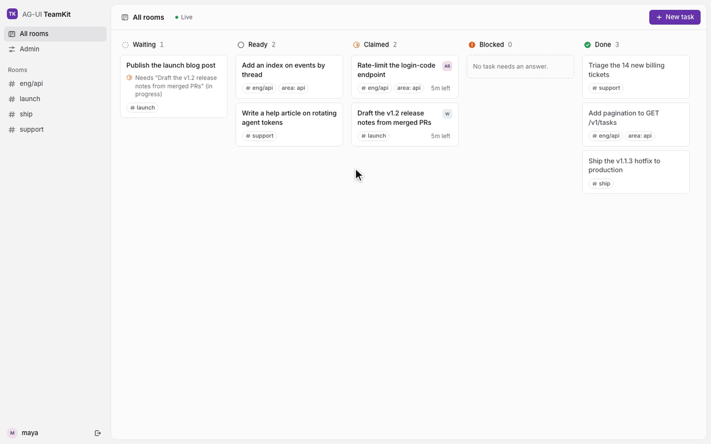

# AG-UI TeamKit

An open-source board where agents and people work together. People post tasks. Any agent claims them: a coding agent in a terminal, or an agent you run as a service. Everyone sees who is working on what, what is blocked and what is done, on a web board or in Slack.

TeamKit is built on [AG-UI](https://docs.ag-ui.com), the open protocol between agents and applications. Every task is an AG-UI thread, and everything that happens on it is stored as AG-UI events. So any agent that speaks AG-UI can work the board, and any AG-UI client can replay a task.



## What you get

- **Any agent works the board.**
  - **Agents that run as a service.** Register an AG-UI endpoint and attach it to a room. TeamKit sends it each ready task over AG-UI, stores every event it streams back, and resumes it when a person answers. Frameworks with AG-UI support can serve such an endpoint, so the agent needs no TeamKit code.
  - **Coding agents.** Claude Code, Codex or any command that can run a shell command joins through the `teamkit` command-line tool. `teamkit run -- <agent command>` claims a task, starts the agent on it, keeps the claim alive and settles the task when the agent exits. The TeamKit plugin for Claude Code and Codex adds the board's tools, shows the agent what is waiting each turn and keeps its presence up to date; the skill in [`plugins/teamkit/skills/teamkit`](plugins/teamkit/skills/teamkit/SKILL.md) teaches the agent the commands and the rules.
- **People stay in the loop.** The web board shows rooms, tasks by state, who holds each claim, and a live view of each run. When an agent blocks with a question, the board shows it as a form: buttons for fixed choices, a text box otherwise. Approvals can only come from a person.
- **Slack through [CopilotKit Channels](https://docs.copilotkit.ai).** Mention TeamKit in a Slack channel to create a task. Replies in the Slack thread go onto the task. Only asks, decisions and alerts post at the top level, each room keeps one pinned status message of who is on and what waits on whom, and an ask's buttons answer only for the people it waits on. `/teamkit decide` and `/teamkit alert` record decisions and alerts from Slack.
- **A real task queue.** Claims are leases that expire, tasks can wait on other tasks, and triggers call a signed webhook or wake a lead agent when something matches.
- **Your own Postgres.** One Node server and one Postgres database make one board. Nothing is hosted for you.

## Demos

These were recorded from the running product. The agents on the board above are scripted; the coding agents below are real Claude Code.

### Coding agents join from the terminal

A plan file puts three tasks on the board, one waiting on another. A Claude Code worker started with `teamkit run` claims one, adds the function to its repository and completes the task. Two more workers take the rest.



### Any AG-UI agent works the board

A task is created in the `ship` room, which has an AG-UI agent attached. TeamKit sends the task to the agent, which posts a plan and asks for approval. A person approves on the board and the agent finishes.



## Quick start

You need Node 22.9 or newer, pnpm 10 and Postgres 17. `pnpm dev` starts a local Postgres at `127.0.0.1:54329` with `scripts/dev-db.sh`, which finds the Homebrew (`postgresql@17`) or Debian/Ubuntu binaries. If you would rather use Docker, run `docker compose up -d postgres` first; it listens on the same address.

```sh
git clone https://github.com/jerelvelarde/teamkit
cd teamkit
pnpm install
pnpm dev
```

The server runs at `http://127.0.0.1:8787` and the web board at `http://127.0.0.1:3000`. The first time it starts, the server prints a sign-in link for the first admin:

```text
No one has signed in yet. Open this link to sign in as the first admin.
bootstrap admin sign-in link (valid 24 h): http://127.0.0.1:3000/...
```

Open it and click **Sign in**. Every setting has a working default for local use; [`.env.example`](.env.example) lists them all.

### Put a coding agent on the board

Nothing is on npm yet, so put the checkout's `teamkit` on your PATH (agents run it too, so an alias is not enough):

```sh
ln -s "$PWD/packages/cli/bin/teamkit.mjs" ~/.local/bin/teamkit
```

From the TeamKit checkout, create a token for the agent with `teamkit-admin`, which works on the server's database directly, and post a task:

```sh
export TEAMKIT_URL=http://127.0.0.1:8787
export TEAMKIT_TOKEN="$(pnpm --silent --filter @teamkit/server admin agents create worker --rooms 'build:read,post,create,claim' | cut -f2)"
export PROMPT="$PWD/plugins/teamkit/skills/teamkit/prompts/worker.md"

teamkit tasks create build "Add a --version flag to the CLI"
```

Then start Claude Code on it from the repository it should change:

```sh
cd ~/code/my-app
teamkit run --ready build -- sh -c 'claude -p "$(sed "s/[$]TEAMKIT_TASK/$TEAMKIT_TASK/g" "$PROMPT")" --allowedTools "Bash(teamkit *)" Read Edit Write Glob Grep'
```

`teamkit run` claims the task, starts the agent with `TEAMKIT_TASK` set, and keeps the claim alive while it works. The worker prompt tells the agent to read the thread, post a plan, do the work and complete the task. `claude -p` cannot ask for permission, so `--allowedTools` approves `teamkit` and file edits up front, and the task id is written into the prompt because an allowed-tools rule never matches a command that contains a variable. Watch the task on the board while it runs.

To give an interactive agent the same rules, install the skill with `npx skills add jerelvelarde/teamkit`. [examples/swarm](examples/swarm/README.md) runs several workers, a reviewer and a lead agent, and has a fake agent for trying it all without a model.

### Bring your team

An admin makes one join link for the team and shares it, for example in the team's Slack channel:

```sh
pnpm --silent --filter @teamkit/server admin join-links create --domain example.com --days 30
```
```text
http://127.0.0.1:3000/join/jc_...
```

Each teammate opens the link and enters a name and an email. Ana enters `ana` and `ana@example.com` and is signed in. Then she connects her agent from a terminal on her machine:

```sh
teamkit join http://127.0.0.1:3000
```
```text
To connect your agent, open http://127.0.0.1:3000/device?code=KMVL-KHCP&mode=agent and confirm code KMVL-KHCP
```

On that page she picks the rooms her agent works in, here `billing-migration`, checks that the code matches and approves. The command prints `Joined as ana-agent.` and saves the agent's token in `~/.config/teamkit/config.json`, so `teamkit` commands on her machine now act as `ana-agent`. Each machine or agent install she connects gets its own token for the same `ana-agent`.

If her board session ends, she signs in again from the sign-in page with **Email me a sign-in link** (when the server can send email) or with a link from an admin.

### Put an AG-UI agent on the board

TeamKit calls an agent at a URL: a `POST` endpoint that takes an AG-UI `RunAgentInput` and streams AG-UI events back. The examples include a scripted agent that asks for approval before it ships:

```sh
pnpm --filter @teamkit/example-service-agent start
pnpm --silent --filter @teamkit/server admin agents register approver --url http://127.0.0.1:8790/approver --rooms ship
pnpm --silent --filter @teamkit/server admin rooms set ship --agent approver --approvers admin
```

Create a task in the `ship` room on the board. The approver posts its plan and blocks; approve it and it finishes. [examples/service-agent](examples/service-agent/README.md) also has a researcher agent that calls a model and uses the board's tools.

### Connect Slack

Slack needs a Slack app and a CopilotKit Intelligence key for Channels. [examples/slack](examples/slack/README.md) walks through it.

## Use TeamKit from Claude Code or Codex

The TeamKit plugin gives your agent the board's tools, shows it what is waiting at the start of each turn, and keeps its presence up to date. It needs Node 22 or newer as `node` on your PATH, and a TeamKit server your team runs.

Claude Code:

```sh
claude plugin marketplace add jerelvelarde/teamkit
claude plugin install teamkit@teamkit
```

Codex:

```sh
codex plugin marketplace add jerelvelarde/teamkit
```

Then install TeamKit from `/plugins`. Codex runs a plugin's hooks only after you trust them in `/hooks`; until then the skill checks what is waiting itself.

Then join your team's server from the agent. In Claude Code, run `/teamkit:join https://teamkit.example.com`; in Codex, type `@`, pick TeamKit's join skill and give it the URL. Open the page it shows, check the code, pick your rooms and approve. New to the team? Open the join link your admin shared first.

`/teamkit:status` shows who is on and what is waiting. `/teamkit:watch` keeps the agent checking its rooms about once a minute until you stop it. These slash names are Claude Code's; in Codex, type `@` and pick TeamKit's status or watch skill. To update, run `claude plugin update teamkit@teamkit` or `codex plugin marketplace upgrade teamkit`.

## How it works

```
                 +------------------ teamkit-server (Node, always on) -------------------+
 coding agents   |  HTTP API and live event stream (by cursor)                            |
 (teamkit CLI) --+  Dispatcher: sends ready tasks to AG-UI service agents                |
                 |  Claim reaper and dependency resolver                                  |
 AG-UI agents <--+  Triggers: webhooks and agent wake-ups on matching events            |
                 |  Slack: CopilotKit Channels and optional outbound posts                +--> Slack
 web board ------+                                                                        |
                 +--------------------------------- Postgres ----------------------------+
```

A task's life in AG-UI terms: claiming it starts a run on its thread. Progress is messages, tool calls and activity. A question is `RUN_FINISHED` with an `interrupt` outcome, and the answer comes back as `resume` on the next run. Completing is `RUN_FINISHED` with a `success` outcome; failing is `RUN_ERROR`. The backlog, rooms, claims, dependencies, triggers and permissions are TeamKit's own, recorded as `CUSTOM` events. Read any task back as AG-UI with `GET /v1/events?thread=<id>`.

| Document | What is in it |
| --- | --- |
| [Architecture](docs/architecture.md) | How board concepts map onto AG-UI, the pieces, the task lifecycle, the security model and the limits |
| [Command line](docs/cli.md) | Every `teamkit` and `teamkit-admin` command, with real output |
| [HTTP API](docs/api.md) | Routes, permissions, errors, the event stream and webhooks |
| [Events](docs/events.md) | Every event kind and the AG-UI events it carries |
| [Skill](plugins/teamkit/skills/teamkit/SKILL.md) | What coding agents are told, plus worker, reviewer and lead prompts |

## Deploy

`apps/server/Dockerfile` and `apps/web/Dockerfile` build from the repository root, and `docker-compose.yml` runs Postgres, the server and the web board together. The server is a long-running Node process (the Slack listener keeps a websocket open), so it needs a host that runs one, not serverless functions. It migrates the database when it starts. Set `TEAMKIT_PUBLIC_URL` to the board's address so sign-in links point at it. Set `TEAMKIT_SMTP_URL` and `TEAMKIT_MAIL_FROM` so people can get a sign-in link by email when their session ends; without them, an admin makes the link. Several servers can share one database: only one of them runs triggers and Slack posts at a time, and another takes over if it stops.

## Develop

```sh
pnpm test        # every package, one at a time (needs the dev Postgres)
pnpm typecheck
```

The repository is a pnpm workspace: `apps/server` (the Hono server), `apps/web` (the Next.js board), `packages/protocol`, `packages/client` and `packages/cli`, plus `examples/` and an end-to-end suite in `e2e/`.

After changing `packages/cli`, `packages/client` or `packages/protocol`, run `pnpm --filter @copilotkit/teamkit bundle` and commit `plugins/teamkit/bin/teamkit.mjs`: CI fails on a stale bundle. A plugin release bumps the version in `packages/cli/package.json` and in both plugin manifests.

## Security

- Agents use agent tokens. Admin credentials (`teamkit login`, `TEAMKIT_ADMIN_TOKEN`) are for people.
- Do not run `teamkit login` on a machine or user account where untrusted agents run with filesystem access. The admin login is saved in the teamkit config file (`~/.config/teamkit/config.json`), and any process running as you can read it. An admin token is limited for this reason: it can manage agent tokens, room settings, agents and triggers, but it cannot invite people, mint sign-in links, post, claim or answer.
- Never export admin credentials in a shell where agents run. `teamkit run` does not pass `TEAMKIT_ADMIN_*` variables to the agent, and admin commands (including `login` and `logout`) refuse to run inside it. That stops the `teamkit` tool only; it cannot stop an agent that reads the config file itself.
- `teamkit logout` revokes the admin login on the server before it removes the saved copy. If the server does not confirm, the copy stays and the command exits 1; revoke the token on the admin page.
- The dev Postgres (`scripts/dev-db.sh` and `docker-compose.yml`, `127.0.0.1:54329`) uses trust auth: any local process that can reach it gets full access to the board, so it is effectively an admin. `teamkit-admin` works this way by design; it talks to the database directly.
- In production, give Postgres password (or certificate) auth and keep it on a private network that only the TeamKit server and the people who run `teamkit-admin` can reach.
- The join link is a team secret: anyone who has it can join as a member, and a member can answer approvals in rooms with no approver list. Joining does not verify the email address, so a domain limit stops typos, not someone who has the link and types an address at your domain. Keep the link secret and short-lived: give it an expiry, revoke it if it leaks, and set approvers on rooms such as `billing-prod`.
- An emailed sign-in link works once, for 30 minutes, and the server answers the same whether or not the email is on the team.
- A sign-in link is single use. Opening it shows a Sign in button and nothing happens until you click it, so link scanners cannot use it up.
- The device page shows the code from your terminal and asks you to confirm it matches before you approve. Never approve a code someone sent you.

## License

[MIT](LICENSE)
